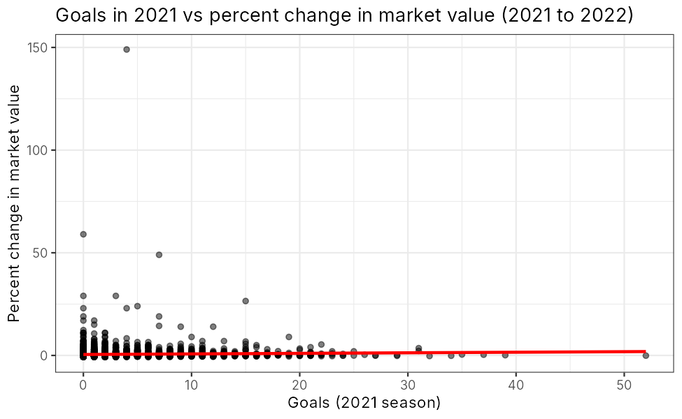

# Football player market values: data pipeline and regression analysis

Group project for STA-310 (statistics) at Grinnell College, Fall 2025, by Bohan, Hung, and Kevin (Kaijian Zheng).

The project asks what is associated with the market value of professional football players on Transfermarkt. This repository contains the code that builds the analysis dataset from four large Transfermarkt-based tables and the regression analysis that follows: does a player's performance in 2021, or his club finishing first in its league table, relate to how his market value changed from 2021 to 2022?

> **Short version of the result.** Goals scored are positively associated with market-value growth, and substitutions and penalty goals are negatively associated, but all models explain at most about 2% of the variance. Playing for a club that finished first in 2021 shows no statistically clear association once those variables are included. Treat this as an exploratory analysis; see [Limitations](#limitations) before reading anything into the coefficients.

## What the code does

1. **`R/01_prepare_data.R`** merges four raw tables into one row per player (4,801 players):
   - market value: the last valuation in each calendar year 2021, 2022 and 2023, for players with valuations in at least two of the three years;
   - player attributes: height, citizenship, EU status, main position, preferred foot, current club;
   - performance totals for the 2021, 2022 and 2023 seasons (goals, assists, appearances, minutes, substitutions, cards, penalty goals, clean sheets), summed over every competition the player appeared in;
   - the league-table rank of the player's club in the 2021, 2022 and 2023 seasons.

   Only players whose club finished first in at least one of those three seasons are kept.

2. **`R/02_analysis.R`** builds the response and fits the models.
   - Response: percent change in market value from 2021 to 2022, `(value_2022 - value_2021) / value_2021`, for players with a positive value in both years (3,910 players; 3,726 with complete predictors).
   - Screening: exhaustive best-subsets regression over 15 candidate variables from the 2021 season.
   - Models: a reduced model with goals, times substituted out and penalty goals, and a full model that adds `champion_2021` (1 if the club has rank 1 in the 2021 table).
   - Checks: residual and Q-Q plots, plus two robustness checks (see below).

## Results

Coefficients are changes in the *fractional* percent change, so 0.07 means 7 percentage points. The median player's value did not change; the mean change is +55%.

| Model (n = 3,726) | Goals (per goal) | Subbed out (per time) | Penalty goals (each) | Champion club 2021 | R² |
|---|---|---|---|---|---|
| Reduced | +0.070 (p < 0.001) | -0.025 (p = 0.009) | -0.185 (p = 0.015) | not included | 0.0045 |
| Full | +0.070 (p < 0.001) | -0.025 (p = 0.009) | -0.185 (p = 0.015) | -0.070 (SE 0.109, p = 0.52) | 0.0046 |

The F-test for adding `champion_2021` gives p = 0.52. Best-subsets adjusted R² never exceeds 0.004 for any model size (`results/best_subsets_criteria.csv`).

Two robustness checks were added while preparing this repository, using the same predictors as the full model:

| Check | n | Champion club 2021 | Goals, subbed out, penalty goals | R² |
|---|---|---|---|---|
| Response replaced by the log change, `log(value_2022) - log(value_2021)` (the team's first definition before it switched to the simple percent change) | 3,726 | +0.035 (p = 0.083) | same signs, all p < 0.01 | 0.018 |
| Percent change with the 5 largest values dropped | 3,721 | +0.014 (p = 0.79) | same signs, all p < 0.01 | 0.010 |

The signs of the three performance variables are the same in all four fits, and the champion indicator is not significant at the 5% level in any of them. All coefficients, standard errors and p-values are in `results/model_coefficients.csv`; full printed output is in `results/model_summaries.txt`.



The scatter plot shows why the linear fit is weak: almost all players sit near zero change, and a few extreme values dominate the least-squares line. 26 players gained more than 1,000%, and the largest gain is 14,900%.

## Repository layout

```
R/
  01_prepare_data.R      raw tables -> data/processed/players_champion_perf_wide.csv
  02_analysis.R          screening, models, robustness checks, plots
data/
  sample/                first 25 rows of the processed table, to show its structure
results/                 coefficient table, best-subsets criteria, full model output
figures/                 diagnostic and descriptive plots
docs/
  analysis_knitted_output.pdf   the knitted PDF of the original analysis notebook
notebooks/
  final1_original.Rmd, player_data_final_original.Rmd   original R Markdown files the scripts came from
  earlier_attempts/      first data-collection attempt with worldfootballR (scratch code, not used for the results)
```

## Reproducing the analysis

Requirements: R 4.x with `readr`, `dplyr`, `tidyr`, `stringr`, `lubridate`, `ggplot2` and `leaps`. Run from the repository root.

```bash
# 1. Put the four raw CSV files in data/raw/ (see "Data"), then build the analysis table
Rscript R/01_prepare_data.R

# 2. Run the models and make the figures
Rscript R/02_analysis.R
```

Both scripts were run on the original raw files and checked against the original outputs. `01_prepare_data.R` reproduces the project's saved analysis table exactly (4,801 rows by 63 columns, every value identical). `02_analysis.R` reproduces the numbers in the original knitted PDF, including the sample sizes, coefficients, F-test and best-subsets adjusted R².

## Data

The raw files are not included: they are large (the performance table alone is 158 MB) and come from Transfermarkt, so check the source's terms before redistributing. The four tables used are `player_market_value.csv`, `player_profiles.csv`, `team_competitions_seasons.csv` and `player_performances.csv`. They are in the format of the Transfermarkt-based football data lake at [salimt/football-datasets](https://github.com/salimt/football-datasets); the project's own copies were downloaded in late 2025. `data/sample/` shows the structure of the processed table.

Columns of the processed table (`players_champion_perf_wide.csv`):

| Column(s) | Meaning |
|---|---|
| `player_id`, `current_club_name` | Transfermarkt player id and the player's current club in the profile table |
| `height`, `citizenship`, `is_eu`, `main_position`, `foot` | Player attributes from the profile table |
| `value_2021`, `value_2022`, `value_2023` | Last market value (euros) recorded in that calendar year |
| `rank_2021`, `rank_2022`, `rank_2023` | League-table rank of the club in the season starting that year (2021 means 2021/22) |
| `goals_`, `assists_`, `nb_in_group_`, `nb_on_pitch_`, `own_goals_`, `subed_in_`, `subed_out_`, `yellow_cards_`, `second_yellow_cards_`, `direct_red_cards_`, `penalty_goals_`, `minutes_played_`, `clean_sheets_` + year | Season totals for the season starting that year, summed over all competitions. `nb_in_group` is matches in the squad and `nb_on_pitch` is matches played. |
| columns ending in `_NA` | Players with no performance record in 2021 to 2023 |

## Limitations

- **Small effect sizes.** The best model explains 0.5% of the variance in percent change (1.8% for the log version). The statistically significant coefficients are real in this sample but tiny in practical terms.
- **Heavy-tailed response.** A handful of players going from a very low to a normal valuation dominate the percent-change response. The Q-Q plot shows strongly non-normal residuals, so the usual p-values should be read loosely.
- **"Champion" is broadly defined.** `champion_2021` means the club has rank 1 in *any* competition table listed for that season, in any division, including lower tiers, youth and reserve leagues. Clubs are matched by name, and where a club has several competition rows in a season, the first row in the file is used (170 of 5,024 club-seasons in 2021 to 2023 have more than one row).
- **The club is the current club, not the 2021 club.** Ranks are attached through `current_club_name` from the profile table, which is the club at the time the profile data was collected. A player who changed clubs after 2021 is matched to his new club's 2021 rank.
- **Selected sample.** Only players whose club topped some table in 2021 to 2023 are in the data, so the comparison is between champions in 2021 and champions in 2022 or 2023, not between champions and all other clubs.
- **Timing.** Performance and rank for "2021" refer to the 2021/22 season, which runs through spring 2022, while `value_2021` and `value_2022` are the last valuations of the calendar years 2021 and 2022. The performance variables therefore overlap the period over which the value change is measured.
- **Variable selection and inference.** Predictors were chosen by best-subsets on the same data later used for the p-values, so the p-values are optimistic.
- **Observational data.** None of the associations should be read as causal.
- **Dropped rows.** Players with a value of zero in 2021 or 2022 are excluded from the percent change, and models drop rows with missing predictors.
- **Notebook versions.** `notebooks/final1_original.Rmd` was last edited after the knitted PDF in `docs/`; its best-subsets step uses the 2022 value as the response, while the PDF uses percent change. The scripts follow the PDF. The notebook also contains a leftover `exp(beta) - 1` conversion that only makes sense for a log response, which is not used in the scripts.

## Project history

The group's project proposal asked whether player market value depends on league, nationality, age, position, and domestic versus international play. The earliest code reflects that question: a first attempt scraped Transfermarkt market values with the `worldfootballR` package and matched them to player statistics by name (`notebooks/earlier_attempts/`), and the final pipeline switched to the larger Transfermarkt-based tables above.

## Credits

Group project by Bohan, Hung, and Kevin (Kaijian Zheng), Grinnell College, Fall 2025.
